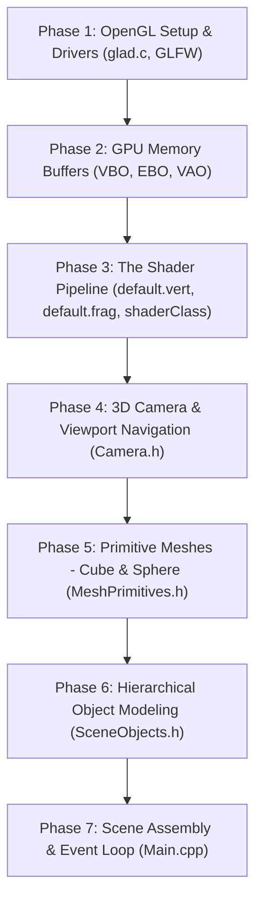

# 🌴 OpenGL Beach Scene Project — Complete Human Workflow & Architecture Guide

Welcome! This guide explains the entire project from ground up. It explains:
1. **The exact chronological order a human would build this project from scratch.**
2. **The exact job and purpose of every single file in the project.**
3. **The core concepts of Hierarchical 3D Modeling so you can create your own objects from scratch using just cubes and spheres.**

---

## 📌 Part 1: The Human Workflow (Step-by-Step Order of Construction)

When a human developer builds a complex 3D OpenGL application without using external 3D models (`.obj`, `.fbx`), they follow this exact 6-phase order:



---

### Phase 1: Window Creation & OpenGL Function Loading
* **Files involved:** `glad.c`, `Libraries/`
* **What you do:**
  1. Set up a C++ project and link `glfw3.lib` and `opengl32.lib`.
  2. Create a GLFW window and an OpenGL 3.3 Core Profile rendering context.
  3. Initialize **GLAD** (`gladLoadGLLoader`) to load all the modern OpenGL function pointers from your GPU driver.
* **Goal:** A blank window appears on screen without crashing.

---

### Phase 2: GPU Memory Management (Buffers)
* **Files involved:** `VBO.h`, `VBO.cpp`, `EBO.h`, `EBO.cpp`, `VAO.h`, `VAO.cpp`
* **What you do:**
  1. Write C++ wrapper classes to manage GPU video memory (VRAM).
  2. **VBO (Vertex Buffer Object):** Uploads raw vertex coordinates, normal vectors, and UV coordinates to the GPU.
  3. **EBO (Element Buffer Object):** Uploads triangle vertex indices to eliminate duplicate vertex data.
  4. **VAO (Vertex Array Object):** Memorizes how vertex attributes are laid out (e.g., location 0 = position, location 1 = normal, location 2 = UV).
* **Goal:** Reusable classes to send 3D geometry to the GPU in clean, organized arrays.

---

### Phase 3: The Shading & Lighting Pipeline
* **Files involved:** `default.vert`, `default.frag`, `shaderClass.h`, `shaderClass.cpp`
* **What you do:**
  1. **`default.vert` (Vertex Shader):** Multiplies 3D model vertices by `Projection * View * Model` matrices (`P * V * M`). Passes normal vectors and world positions to the fragment shader.
  2. **`default.frag` (Fragment Shader):** Calculates pixel colors using the **Phong Reflection Model**:
     $$\text{Color} = (\text{Ambient} + \text{Diffuse} + \text{Specular}) \times \text{ObjectColor}$$
     Includes an `unlit` toggle for glowing celestial objects like the Sun.
  3. **`shaderClass`:** Helper class that reads GLSL text files from disk, compiles them with the GPU's GLSL compiler, checks for syntax errors, and links them into a runnable GPU program.
* **Goal:** A working lighting engine that gives 3D shapes realistic highlights, shadows, and colors.

---

### Phase 4: Camera & 3D Navigation
* **Files involved:** `Camera.h`
* **What you do:**
  1. Implement an **Orbit / Arcball Camera**:
     - Calculates position using spherical coordinates: $X = R \cos(\text{pitch}) \sin(\text{yaw})$, $Y = R \sin(\text{pitch})$, $Z = R \cos(\text{pitch}) \cos(\text{yaw})$.
     - Produces the View Matrix using `glm::lookAt(position, target, up)`.
  2. Handle mouse dragging to orbit around the scene, mouse scroll to zoom in/out, and keyboard (`W`/`A`/`S`/`D`/`R`) to pan or reset.
* **Goal:** You can rotate, zoom, and inspect your 3D world from any angle.

---

### Phase 5: Building Block Meshes (Cube & Sphere)
* **Files involved:** `MeshPrimitives.h`
* **What you do:**
  * In keeping with the course requirement: **"Don't use any builtin or imported 3D models. Build everything by transforming cubes or spheres."**
  * Create procedural base meshes:
    1. **`CubeMesh`**: A $1 \times 1 \times 1$ unit cube centered at $(0, 0, 0)$ with 24 vertices (4 per face with outward-pointing normals) and 36 indices.
    2. **`SphereMesh`**: A procedurally generated sphere with rings (latitude) and sectors (longitude), with radial normal vectors $\vec{N} = \text{normalize}(\vec{P})$.
    3. **`CanopyGoreMesh`**: A specialized double-sided 12-sector curved wedge for umbrella canopies.
  * Create helper functions `drawTransformedCube()` and `drawTransformedSphere()` that take a `glm::mat4 model` matrix, upload it to the shader uniform, and call `glDrawElements()`.
* **Goal:** You now have pure geometric primitives ready to be scaled, rotated, and translated into any object.

---

### Phase 6: Hierarchical Object Modeling
* **Files involved:** `SceneObjects.h`
* **What you do:**
  * Build the 9 scene objects piece-by-piece by assembling transformed cubes and spheres using parent-child matrix hierarchies:
    1. **Robot** (replaces human): Articulated joints, rotating head, waving arms, seated legs.
    2. **Umbrella**: Tiltable pole with joint knuckle, 12-sector seamless canopy, top finial.
    3. **Beach Lounger Chair**: 4 vertical legs, reclined backrest, wooden slats, fabric seat cushion.
    4. **Sailboat**: Layered angled planks for a realistic V-hull, tapered wedge bow, mast, boom, triangular sails.
    5. **Palm Tree**: Stacked curved trunk segments, visible coconut cluster, 3 cascading tiers of downward-arching fronds with pairs of feathery leaflets.
    6. **Coastal Rocks**: Multi-cube irregular composite boulders with moss patches.
    7. **Sun**: High-altitude unlit emissive sphere.
    8. **Sand Beach**: Large ground plane.
    9. **Sea**: Expansive reflective ocean water plane.
* **Goal:** Complete modular drawing functions for every object, with editable parameters.

---

### Phase 7: Main Loop, Composition & Interaction
* **Files involved:** `Main.cpp`
* **What you do:**
  1. Initialize window, camera, shaders, and primitive meshes.
  2. Set up interactive controls (keys `1`/`2` to turn the robot's head, keys `3`/`4` to tilt the umbrella).
  3. Enter the render loop:
     - Clear screen (`glClear(GL_COLOR_BUFFER_BIT | GL_DEPTH_BUFFER_BIT)`).
     - Send camera matrices to the shader.
     - Call object draw functions with well-spaced world transforms so nothing overlaps.
     - `glfwSwapBuffers` and `glfwPollEvents`.
  4. Clean up GPU resources on exit.
* **Goal:** The complete, interactive beach resort application.

---

## 📂 Part 2: File-by-File Job Directory

| File Name | Primary Job / Role | Key Functions / Classes |
| :--- | :--- | :--- |
| **`glad.c`** | Loads modern OpenGL 3.3+ function pointers directly from your graphics card driver at runtime. | `gladLoadGLLoader()` |
| **`VBO.h` / `VBO.cpp`** | **Vertex Buffer Object**: Manages raw vertex data in GPU memory (positions, normals, texture coordinates). | `VBO::Bind()`, `VBO::Unbind()`, `VBO::Delete()` |
| **`EBO.h` / `EBO.cpp`** | **Element Buffer Object**: Manages index lists so the GPU can reuse shared vertices when rendering triangles. | `EBO::Bind()`, `EBO::Unbind()`, `EBO::Delete()` |
| **`VAO.h` / `VAO.cpp`** | **Vertex Array Object**: Remembers the memory layout and links vertex attributes (position, normal, UV) to the VBO. | `VAO::LinkAttrib()`, `VAO::Bind()` |
| **`default.vert`** | **Vertex Shader**: Runs on the GPU for every vertex. Transforms 3D object vertices into 2D screen space (`gl_Position = proj * view * model * pos`). | GLSL Vertex Shader |
| **`default.frag`** | **Fragment Shader**: Runs on the GPU for every pixel. Calculates Phong lighting (Ambient + Diffuse + Specular highlights) and materials. | GLSL Fragment Shader |
| **`shaderClass.h` / `.cpp`** | Helper class that reads shader text files from disk, compiles them into GPU bytecode, and checks for compile errors. | `Shader::Shader()`, `Shader::Activate()` |
| **`Camera.h`** | Orbit/pan/zoom camera system. Handles mouse and keyboard input and computes `View` and `Projection` matrices. | `Camera::GetViewMatrix()`, `Camera::handleMouse()` |
| **`MeshPrimitives.h`** | Creates and stores pure geometric shapes (**Cube**, **Sphere**, **Canopy Gore**). Has zero external dependencies. | `CubeMesh`, `SphereMesh`, `CanopyGoreMesh` |
| **`SceneObjects.h`** | Contains all object recipes. Transforms primitive cubes and spheres into chairs, robots, boats, palms, and umbrellas. | `drawRobot()`, `drawUmbrella()`, `drawBoat()`, `drawPalmTree()` |
| **`Main.cpp`** | Application entry point (`main()`). Manages the GLFW window, main render loop, input processing, and scene composition. | `main()`, `key_callback()`, render loop |

---

## 🛠️ Part 3: How to Create Your Own Objects from Scratch

To create any custom object using only a unit cube and a unit sphere, follow this **4-Step Mental Model**:

### Step 1: Mentally Deconstruct the Real Object
Break down the complex real-world object into simple geometric primitives:
* **Chair** = 4 thin vertical boxes (legs) + 1 flat horizontal box (seat) + 1 tilted box (backrest).
* **Robot Arm** = 1 sphere (shoulder joint) + 1 box (upper arm) + 1 sphere (elbow joint) + 1 box (forearm) + 1 small box (hand).
* **Boat** = 1 narrow bottom box (keel) + angled side boxes (planks) + 1 vertical pole (mast) + 1 horizontal pole (boom) + flat triangular slices (sails).

---

### Step 2: The Transform Matrix Sequence (Scale $\rightarrow$ Rotate $\rightarrow$ Translate)
When you have a unit cube (size $1 \times 1 \times 1$ centered at $0, 0, 0$):
* To make a tabletop of width 2.0, thickness 0.1, and length 1.5 at height 0.8:
```cpp
glm::mat4 model = glm::mat4(1.0f);
// 1. Move to desired position in the world
model = glm::translate(model, glm::vec3(0.0f, 0.8f, 0.0f));
// 2. Rotate if needed
model = glm::rotate(model, glm::radians(angle), glm::vec3(0.0f, 1.0f, 0.0f));
// 3. Stretch the unit cube into the desired box dimensions (X, Y, Z)
model = glm::scale(model, glm::vec3(2.0f, 0.1f, 1.5f));

// 4. Draw it!
drawTransformedCube(shader, cube, model, tableColor);
```

> [!IMPORTANT]
> **Matrix Multiplication Order in GLM:**
> In GLM, transformations are written in the order: **Translate $\rightarrow$ Rotate $\rightarrow$ Scale**.
> Because of column-major matrix multiplication, this applies **Scale first**, then **Rotation**, then **Translation** to the vertices!

---

### Step 3: Hierarchical (Parent-Child) Modeling
When one part of an object moves or rotates, all parts attached to it must move along with it (e.g., tilting an umbrella pole must tilt the canopy; turning a robot's body must turn its head and arms).

In code, this is achieved by **chaining matrices**:

```cpp
// 1. PARENT NODE (Lower pole)
glm::mat4 lowerPole = glm::translate(baseTransform, glm::vec3(0.0f, 0.5f, 0.0f));
drawTransformedCube(shader, cube, glm::scale(lowerPole, glm::vec3(0.1f, 1.0f, 0.1f)), color);

// 2. HIERARCHICAL JOINT NODE (Tilt knuckle)
glm::mat4 tiltJoint = glm::translate(baseTransform, glm::vec3(0.0f, 1.0f, 0.0f));
tiltJoint = glm::rotate(tiltJoint, glm::radians(tiltAngle), glm::vec3(0.0f, 0.0f, 1.0f));

// 3. CHILD 1 (Upper pole inherits tiltJoint)
glm::mat4 upperPole = glm::translate(tiltJoint, glm::vec3(0.0f, 1.0f, 0.0f));
drawTransformedCube(shader, cube, glm::scale(upperPole, glm::vec3(0.08f, 2.0f, 0.08f)), color);

// 4. CHILD 2 (Canopy inherits upperPole - automatically tilted!)
glm::mat4 canopyApex = glm::translate(upperPole, glm::vec3(0.0f, 1.0f, 0.0f));
// Draw canopy here...
```

---

### Step 4: Radial Loops for Circular Symmetries
Objects like umbrellas, wheels, flowers, and palm trees have radial symmetry. Instead of hand-coding every piece, use a `for` loop that rotates around the Y-axis:

```cpp
int sectors = 8;
for (int i = 0; i < sectors; ++i)
{
    float angle = (float)i * (360.0f / sectors);
    glm::mat4 petalMat = glm::rotate(centerNode, glm::radians(angle), glm::vec3(0.0f, 1.0f, 0.0f));
    petalMat = glm::translate(petalMat, glm::vec3(0.0f, 0.0f, 1.5f)); // offset outward
    petalMat = glm::scale(petalMat, glm::vec3(0.4f, 0.05f, 1.2f));   // shape petal
    drawTransformedCube(shader, cube, petalMat, petalColor);
}
```

---

## 🎓 Viva / Presentation Tips
If your teacher asks you:
1. *"How did you make this object without importing a 3D model?"*
   * **Answer:** *"I constructed it entirely in `SceneObjects.h` using parametric unit cubes and unit spheres defined in `MeshPrimitives.h`. I applied hierarchical affine transformations (`glm::translate`, `glm::rotate`, `glm::scale`) to shape and position each component."*
2. *"Can you change the angle or size of this part right now?"*
   * **Answer:** *"Yes! Every object function in `SceneObjects.h` accepts modular parameters (such as `g_robotHeadYaw`, `g_umbrellaTilt`, `g_palmTrunkCurve`). I can change them in real time using keys or edit the argument in `Main.cpp`."*
3. *"How does the lighting work?"*
   * **Answer:** *"In `default.vert` and `default.frag`, we calculate the Phong reflection model. Normals are transformed by the inverse transpose of the model matrix, and the fragment shader computes ambient, diffuse (Lambertian cosine), and specular (Blinn-Phong specular highlight) components."*
